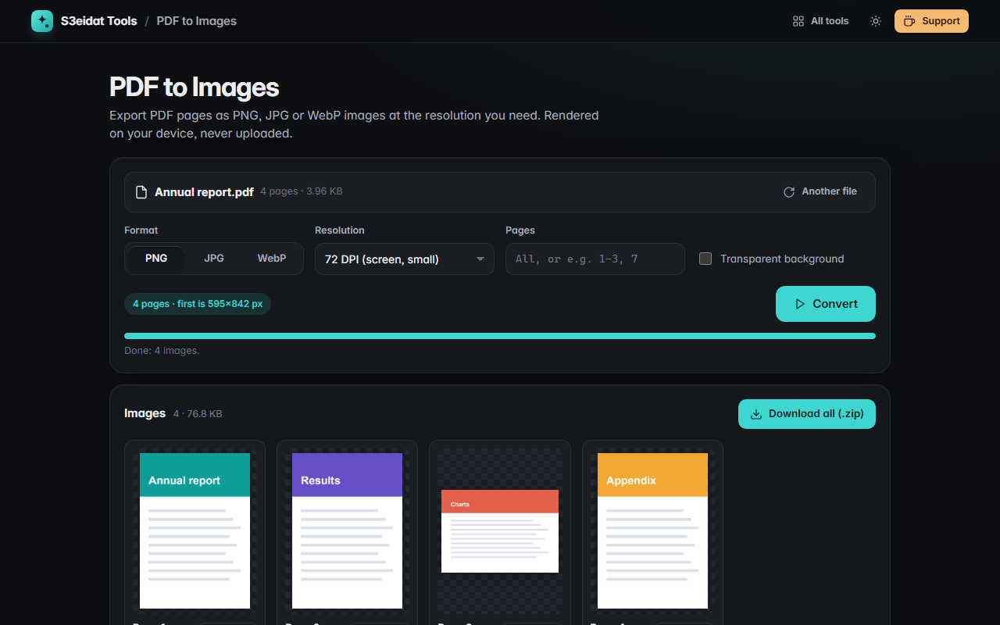

# PDF to Images

> Export PDF pages as PNG, JPG or WebP images. Free, private, and it runs entirely in your browser.

### ▶ [Open PDF to Images](https://s3eidat.github.io/pdf-to-images/)



## Features

- **PNG, JPG or WebP** (WebP where the browser can write it), with a quality slider for JPG/WebP
- **Resolution** from 72 to 600 DPI; the pixel size of the first page is shown before you start
- **Pick pages**: all, or ranges like `1-3, 7`
- **Transparent background** option for PNG/WebP
- Live **progress** with a Stop button; each finished page appears right away
- Download pages **one by one** or **all as a zip**
- Very large pages are scaled down just enough to fit the browser's canvas limit, and marked "capped"
- Clear error for PDFs that need a password

## Privacy

Your PDF never leaves your device: pages are rendered by PDF.js in this tab. There is no server, no account, no analytics.
The page ships with a strict Content-Security-Policy (`connect-src 'self'`), so the browser itself blocks any attempt to send
data anywhere. Only your settings are remembered in this browser.

## Run it yourself

It's plain HTML, CSS and JavaScript with no build step:

```bash
git clone https://github.com/s3eidat/pdf-to-images
cd pdf-to-images
python -m http.server 8000
```

Then open http://localhost:8000.

## Credits

Rendering by [PDF.js](https://mozilla.github.io/pdf.js/) (Mozilla, Apache-2.0), shipped in `lib/`.

## Support

If this saved you time, **[buy me a coffee ☕](https://s3eidat.github.io/coffee/)**. It keeps every tool free.

---

Part of **[S3eidat Tools](https://s3eidat.github.io/)**: 100+ free, private tools that run in your browser. MIT licensed.
